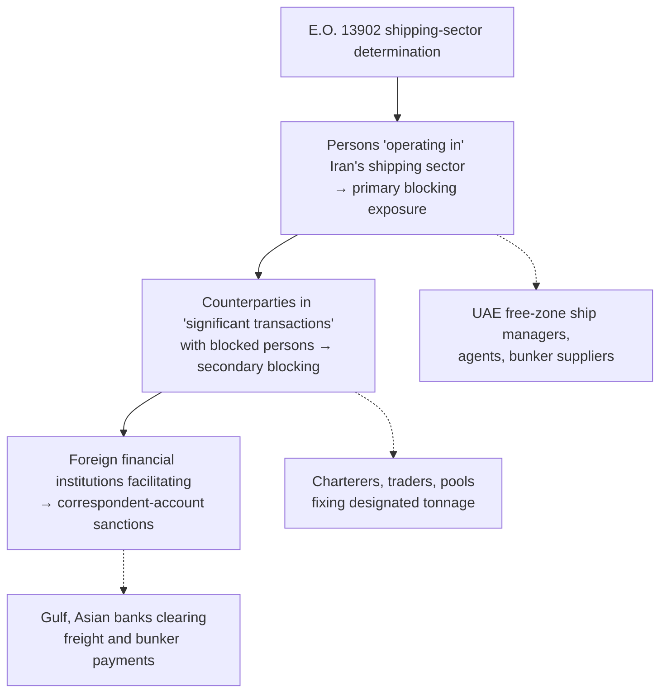

# "Operation Economic Outcast" — Treasury's Iran Sector Determinations and the Shadow-Fleet Campaign (August–October 2026)

> **Cross-reference (Nov 2026):** BIS relied on the 8 Sep 2026 Economic Outcast designations in renewing the Mahan Airways TDO on 22 Oct 2026, stating that some of the designated UAE/Türkiye/Malaysia entities helped Mahan acquire three further Boeing 777s via the UAE and Oman in summer 2026. See [BIS — Mahan Airways TDO Renewal](2026-10-bis-mahan-airways-tdo-renewal.md).

On 24 August 2026 the US Department of the Treasury announced a coordinated Iran sanctions campaign branded **"Operation Economic Outcast"**, described by Treasury as an economic "D-Day" intended to close every financial channel sustaining the Iranian regime and the IRGC. The package combined new **sector determinations under E.O. 13902** — adding shipping, aviation, digital assets, gold and technology to the existing financial, petroleum and petrochemical sectors — with nearly 60 designations, suspension of several Iran general licences, and OFAC guidance on the sanctions risk of acceding to Iranian demands in the Strait of Hormuz.

For the maritime sector the significance is structural rather than incremental: a **shipping-sector determination under E.O. 13902 exposes any person, anywhere, who knowingly operates in Iran's shipping sector or engages in a significant transaction with a person in it to secondary (blocking) sanctions**, and foreign financial institutions that facilitate such transactions to correspondent-account sanctions. Several of the maritime designations are UAE free-zone entities, which places the action squarely within the UAE compliance perimeter.

The campaign's second major maritime action followed on **8 October 2026**, when OFAC designated **17 shadow-fleet vessels and 18 owning companies** under E.O. 13902, claiming to have neutralised "the vast majority" of Iran's remaining shadow fleet. That action — with its full vessel/IMO table — is covered in [Part II](#part-ii-8-october-2026-shadow-fleet-action) below.

> **Source and verification status:** Part I is built from the Chalos & Co summary of the 24 August announcement and the E.O. 13902 framework; its designation details should be confirmed against the OFAC Recent Actions entry for 24 Aug 2026 before reliance. Part II is drawn directly from the Treasury press release of 8 October 2026 (primary source) and is verified. Items not independently confirmed from OFAC primary text are flagged below.

---

# Part I — 24 August 2026: Sector Determinations and Launch

---

## Key Facts

- **Announced:** 24 August 2026, US Department of the Treasury
- **Branding:** "Operation Economic Outcast" — Treasury characterised it as an economic "D-Day"
- **Primary authorities:** E.O. 13902 (sector determinations under § 1(a)(i), made by Treasury in consultation with State; petroleum-sector designations); E.O. 13224 (counterterrorism — IRGC-Qods Force and NIOC-linked designations)
- **New sector determinations (E.O. 13902):** **shipping**, aviation, digital assets, gold, technology — building on financial sector (2020) and petroleum / petrochemical sectors (2024)
- **Designations:** nearly 60 entities, individuals and vessels across multiple jurisdictions
- **General licences suspended:** several authorising certain remittance payments and Iranian access to US cultural and academic channels
- **Guidance:** OFAC guidance on sanctions risks of complying with Iranian demands related to transit of the Strait of Hormuz
- **Targets:** IRGC and IRGC-Qods Force; National Iranian Oil Company (NIOC); shadow-fleet shipping network and oil-revenue facilitators; nuclear/missile procurement and cyber networks

---

## The Four Coordinated Actions

| # | Action | Instrument | Effect |
|---|---|---|---|
| 1 | Sector determinations | E.O. 13902 § 1(a)(i) | Exposes any person operating in Iran's shipping, aviation, digital-asset, gold or technology sectors — regardless of location — to blocking sanctions; secondary sanctions on FFIs facilitating significant transactions |
| 2 | Designations | E.O. 13902 / E.O. 13224 | ~60 persons, entities and vessels added to SDN List; identified tankers blocked as property |
| 3 | GL suspensions | Iranian Transactions and Sanctions Regulations (31 C.F.R. Part 560) | Narrows humanitarian/remittance and academic-exchange channels |
| 4 | Hormuz guidance | OFAC guidance | Warns that payments or concessions to Iranian authorities to secure transit may themselves be sanctionable |

---

## Maritime-Relevant Designations

| Designated party | Jurisdiction | Authority | Basis (as reported) |
|---|---|---|---|
| Mohammad Ahmed Suhil Fattouh ("Captain Hamzah") and **Amdeh Ship Management** | UAE | E.O. 13224 | Material support to NIOC |
| Ivan Obukhov and **Foscom FZE** | UAE | E.O. 13224 | Facilitating IRGC-Qods Force oil sales, incl. > USD 100 m in cryptocurrency payments |
| **Azure Shipping**, Mansoor Tayabbhai Gandhi and related entities | Singapore | E.O. 13902 | Operating in Iran's petroleum sector |
| **Wellbred** commodities-trading group (Shamkhani-linked) | Multiple, incl. a French cooking-oil refinery acquired 2024 | E.O. 13902 | Petroleum-sector operations; illustrates layering through non-energy assets |
| Five shadow-fleet vessel owners and their tankers | Multiple | E.O. 13902 (petroleum sector) | Vessels that moved millions of barrels of Iranian crude and products; identified as blocked property |

> **Verification note:** names and bases are as summarised by Chalos & Co; confirm against the SDN entries (programme tags SDGT / IRAN-EO13902) before use in screening files. [Single-sourced to a law-firm summary]

---

## Mechanism: Why a Shipping-Sector Determination Changes the Risk Calculus

E.O. 13902 (January 2020) authorises Treasury, in consultation with State, to determine that a sector of the Iranian economy is subject to sanctions. Once a sector is designated:

1. **Any person** determined to *operate in* that sector may be blocked — nationality and location are irrelevant.
2. **Any person** who knowingly engages in a **significant transaction** for or on behalf of a person blocked under the order may themselves be blocked (secondary sanctions).
3. **Foreign financial institutions** that knowingly facilitate significant transactions for blocked persons face correspondent/payable-through account sanctions.

The 2024 petroleum and petrochemical determinations already captured tanker operators carrying Iranian crude. The **shipping determination** widens the net to the ecosystem around the cargo: ship managers, crewing agents, bunker suppliers, port agents, STS service providers, classification and flag intermediaries, and the trading houses that charter the tonnage. The "operates in the shipping sector of Iran" formulation does not require the Iranian cargo itself to be sanctioned — it is enough to be in the Iranian shipping sector.

### The Hormuz guidance

OFAC's guidance on Iranian demands in the Strait of Hormuz addresses a scenario in which Iranian authorities condition safe passage on payments, declarations or routing concessions. The guidance signals that acceding to such demands may itself constitute a sanctionable transaction with the IRGC or its affiliates. For operators transiting the Gulf this creates a direct tension between **navigational safety** and **sanctions exposure** that charterparty war-risk and sanctions clauses were not drafted to resolve.

---

## Doctrinal Significance

### 1. Sector determinations as the dominant Iran tool

Since 2020 the E.O. 13902 sector mechanism has progressively replaced itemised designations as the primary Iran lever: financial (2020) → petroleum/petrochemical (2024) → shipping, aviation, digital assets, gold, technology (2026). The design intent is to make *participation in an economic sector* the trigger, shifting the compliance burden from "is my counterparty on the list?" to "does my counterparty operate in a designated Iranian sector?" — a question that list-screening alone cannot answer. Compare the OFAC 50% Rule's analogous move from list-matching to ownership analysis ([OFAC UBO & 50% Rule](../regulations/ofac-ubo-50-percent-rule.md)).

### 2. Digital assets and gold as shipping-adjacent channels

The Foscom FZE designation (crypto payments for IRGC-QF oil) and the gold-sector determination reflect the settlement layer of the shadow-fleet trade. Freight, demurrage and bunker payments for sanctioned cargoes increasingly clear outside correspondent banking. The digital-asset determination gives OFAC a sector hook on exchanges and OTC desks in the UAE and elsewhere that service these flows — see the blockchain-intelligence analysis in the repository's [Sweeper and the Freeze](https://github.com/felipelago17) work.

### 3. UAE exposure

Two of the named maritime designations are UAE free-zone companies. Read alongside the [BIS Affiliates Rule](../regulations/uae/bis-affiliates-rule.md) and the [UAE local designations register](../jurisdictions/uae/2026/local-designations-2026.md), the pattern is consistent: Washington treats UAE free zones as the principal jurisdiction of incorporation for Iran- and Russia-linked maritime intermediaries, and UAE-based compliance functions should assume enhanced scrutiny of any shipping, bunkering or agency counterparty domiciled in a free zone with Gulf tanker exposure.

### 4. Convergence with the Russia shadow-fleet programme

The Iranian and Russian shadow fleets share tonnage, managers, flags and insurers. Vessels designated under E.O. 13902 frequently reappear in UK/EU Russia designations (see [UK Russia Shadow Fleet, June 2026](../jurisdictions/uk/2026/russia-shadow-fleet-june-2026.md)). A single screening architecture covering both programmes — vessel IMO history, beneficial-ownership chains, P&I status, AIS behaviour — is now the minimum standard.

---

# Part II — 8 October 2026: Shadow-Fleet Action

On 8 October 2026 Treasury announced, under the Operation Economic Outcast banner, designations of **17 vessels and 18 owning companies** under E.O. 13902 — thirteen companies under the petroleum/petrochemical-sector determination and five under the petrochemical-sector determination (Brich Shipping appears in both). Secretary Bessent's statement framed the action as "starving" the regime of oil revenue; the release ties the campaign to the US military blockade and "dwindling Iranian oil shipments outside the blockade line". The release claims the action "effectively neutralizes the vast majority of Iran's remaining shadow fleet network" — a characterisation, not a verifiable metric, and one Treasury itself qualifies by noting the ecosystem is "fluid, with vessels routinely entering and exiting the network".

### Key facts — 8 October action

- **Authority:** E.O. 13902 (petroleum and petrochemical sector determinations)
- **Vessels:** 17, identified as blocked property; registered across more than a dozen flags (Comoros, Panama, Bahamas, Mongolia, Palau, Cameroon, Zanzibar/Tanzania, Sierra Leone, Vanuatu, Hong Kong, San Marino, Gambia)
- **Owners:** 18 companies, predominantly Marshall Islands SPVs, plus China, Hong Kong, BVI and one UK-registered/China-based entity
- **Cargoes:** crude, naphtha, HSFO, methanol, ammonia, LPG (propane/butane, ethylene), bitumen/asphalt — i.e. the **petrochemical and products tail** of the trade, not only crude
- **Destinations:** South and East Asia (China, India, Pakistan, Middle East)
- **Delistings in the same action:** HAKUNA MATATA (IMO 9354167) and PINOCCHIO (IMO 9400112), designated June 2025, removed after sale to non-sanctioned operators
- **Coordinated State Department action** (reported, not in the Treasury release): additional entities, individuals and vessels

### Designated vessels

| # | Vessel | IMO | Flag | Type | Owner (jurisdiction) | Reported cargo |
|---|---|---|---|---|---|---|
| 1 | PARITOSH | 9383352 | Comoros | Bitumen tanker | Paritosh Shipping Inc (MI) | >100 k bbl bitumen/asphalt, 2026 |
| 2 | BITU | 9531765 | Panama | Bitumen tanker | Ornella Shipping Inc (MI) | >170 k bbl bitumen/asphalt, 2026 |
| 3 | STARWAY | 9273246 | Panama | — | Hechuang International Group (China) | >3 m bbl naphtha since 2025 |
| 4 | GAS LUCKY | 9177557 | Bahamas | LPG | Shunhang Ship Management Ltd (China) | >500 k bbl ethylene since 2025 |
| 5 | G SPRING | 9040118 | Mongolia | LPG | JLS Dragon Co Ltd (HK) | >1 m bbl-eq LPG to China since 2021 |
| 6 | KANHA | 9308766 | Palau | Products | Kanha Shipping Inc (MI) | >3 m bbl HSFO to Middle East/India since 2021 |
| 7 | KING CHAIN | 9277761 | Cameroon | Products | Saint Abundant International Co Ltd (UK-reg., China-based) | Several m bbl methanol to China since 2023 |
| 8 | POLAR | 9050187 | Zanzibar | LPG | Terra Nav Shipping Ltd (MI) | >100 k bbl propane/butane to Pakistan since 2025 |
| 9 | MACKEREL | 9234628 | Panama | Chem/products | Betta Shipping Inc (MI) | >500 k bbl HSFO since Dec 2025 |
| 10 | GAS MARAKUA | 9240421 | Sierra Leone | LPG | Makarua Shipping Ltd (BVI) | >1 m bbl propane/butane since late 2025 |
| 11 | ZIXUAN | 9317298 | Vanuatu | LPG | Goddess Shipping Corp (MI) | >1 m bbl propane/butane since Oct 2025 |
| 12 | AVA 6 | 9226140 | Hong Kong | Chem/products | Standwill Shipping Ltd (HK) | >1 m bbl naphtha since Sep 2025 |
| 13 | TINA 5 | 9237761 | Vanuatu | Crude | Nostalgia Company Ltd (MI) | >1.5 m bbl crude, Aug 2026 |
| 14 | SOGL | 9208227 | Comoros | LPG | Gravion Maritime Company (MI) | >2 m bbl propane/butane since Sep 2025 |
| 15 | NOBLE SEA | 9343118 | San Marino | LPG | Brich Shipping Co Ltd (HK) | >2 m bbl ammonia + propane/butane since mid-2025; 200 k bbl methanol Jun 2026 |
| 16 | SHENZHEN | 9276561 | Cameroon | Crude | Northport Navigation Inc (MI) | >3.5 m bbl crude since Nov 2025 |
| 17 | EXFLAME | 9294678 | Gambia | Products | Science Ru Trading Co Ltd (MI) | >400 k bbl methanol since mid-2026 |

MI = Marshall Islands; HK = Hong Kong; BVI = British Virgin Islands. Source: Treasury press release, 8 Oct 2026. Volumes are Treasury's characterisations.

### What the 8 October list tells a screening function

1. **Flags of convenience have migrated down-market.** Comoros, Cameroon, Gambia, Sierra Leone, Zanzibar, Mongolia, San Marino and Vanuatu — registries with limited enforcement capacity — dominate. A fleet-screening rule that treats these flags on Gulf tanker trades as a red flag in their own right is now defensible.
2. **Marshall Islands SPV ownership is the default wrapper.** Eleven of eighteen owners are Marshall Islands entities — single-ship companies with no operating history. The 50% Rule analysis has to run through the SPV to the beneficial controller, who is typically in China, Hong Kong or the UAE ([OFAC UBO & 50% Rule](../regulations/ofac-ubo-50-percent-rule.md)).
3. **The petrochemical tail is now the primary target.** Twelve of seventeen vessels carry LPG, methanol, ammonia, naphtha or bitumen rather than crude. Operators and traders in the petrochemical and gas-carrier segments — historically lighter-touch on Iran screening than crude tanker owners — are squarely in scope.
4. **Vintage tonnage.** IMO numbers in the 90xxxxx–93xxxxx range indicate vessels largely built 1993–2008. Age plus flag plus SPV ownership plus Gulf/China routing is a four-factor profile that should trigger enhanced review regardless of list status.
5. **Delisting is real and conditions it.** The HAKUNA MATATA and PINOCCHIO removals after sale to non-sanctioned operators show OFAC's willingness to release vessels when ownership actually changes — relevant to S&P transactions involving ex-designated tonnage and to the diligence file a buyer must build to obtain a delisting.

### Campaign chronology

| Date | Action |
|---|---|
| 24 Aug 2026 | Launch ("Economic D-Day"): five new E.O. 13902 sector determinations; ~60 designations; GL suspensions; Hormuz guidance |
| Sep 2026 | Reported expansion to banking, aviation, automotive, rail and metals sectors (per secondary reporting — verify) |
| 1 Oct 2026 | Action against Russia-linked A7 shadow-banking network; Iranian automotive and rail designations (per secondary reporting — verify) |
| 8 Oct 2026 | 17 shadow-fleet vessels and 18 owners designated; two vessels delisted; parallel State Department designations reported |

---

## Compliance Takeaways

**Shipowners, managers and pools**

- Re-screen the entire counterparty chain — not only charterers and cargo interests, but technical managers, crewing agents, bunker suppliers and port agents — against the new SDN entries and for "operates in the Iranian shipping sector" indicators.
- Treat UAE free-zone ship-management and agency counterparties with Gulf tanker exposure as enhanced-due-diligence by default.
- Review sanctions and war-risk clauses for Hormuz transits: the right to refuse orders that would require payments or concessions to Iranian authorities should be explicit.

**Charterers and traders**

- Add E.O. 13902 sector-determination language to KYC declarations and sanctions warranties; a counterparty's *sector* is now a representable fact.
- Document the basis for concluding a fixture is not a "significant transaction" with a blocked person — OFAC's significance factors (size, number, frequency, nature, management awareness, nexus to blocked persons) should be addressed in the file.

**Banks and payment intermediaries**

- Map freight, demurrage and bunker payment flows for Gulf tanker trades; the digital-asset and gold determinations mean non-bank settlement channels are now in scope.
- Confirm that correspondent-account sanctions exposure under E.O. 13902 § 2 is reflected in FFI risk assessments for GCC and South/South-East Asian relationships.

**Insurers and P&I** *(not addressed in the Chalos summary; added as repository analysis)*

- Cover for vessels or managers designated under E.O. 13902 is itself a prohibited service for US persons and a secondary-sanctions risk for non-US insurers; sanctions-exclusion and cancellation triggers should reference sector determinations, not only SDN listing.

---

## Contested and Unverified Items

| Item | Status |
|---|---|
| Exact designation count ("nearly 60") | Per Chalos summary; confirm against OFAC Recent Actions, 24 Aug 2026 |
| Named designees and bases | Per Chalos summary; verify SDN entries |
| Scope of GL suspensions | Chalos identifies remittance and cultural/academic GLs; specific GL numbers not stated |
| Text of Hormuz guidance | Not reproduced in source; obtain from OFAC |
| Insurer / P&I implications | Repository analysis, not stated in source |

---

## Sources

**Primary**

- Executive Order 13902, *Imposing Sanctions With Respect to Additional Sectors of Iran* (10 Jan 2020), 85 FR 2003
- Executive Order 13224, as amended, *Blocking Property and Prohibiting Transactions With Persons Who Commit, Threaten To Commit, or Support Terrorism*
- OFAC, Recent Actions, 24 August 2026 (Iran-related designations; sector determinations; GL actions; Hormuz guidance) — to be linked on verification
- 31 C.F.R. Part 560 (Iranian Transactions and Sanctions Regulations); 31 C.F.R. Part 561 (Iranian Financial Sanctions Regulations)

**Secondary**

- Chalos & Co, P.C., "US Treasury's 'Operation Economic Outcast' elevates Sanctions risk for Shipping Industry", 25 Aug 2026 — <https://chaloslaw.com/us-treasurys-operation-economic-outcast-elevates-sanctions-risk-for-shipping-industry/>

**Related pages in this repository**

- [Sanctions — Oil & Energy](../regulations/sanctions-oil-energy.md)
- [OFAC UBO & 50% Rule](../regulations/ofac-ubo-50-percent-rule.md)
- [Australia — Iran Autonomous Sanctions 2026](../jurisdictions/australia/2026/iran-autonomous-sanctions-2026.md)
- [UK — Russia Shadow Fleet, June 2026](../jurisdictions/uk/2026/russia-shadow-fleet-june-2026.md)
- [UAE — Local Designations 2026](../jurisdictions/uae/2026/local-designations-2026.md)

---

*Case study prepared 6 November 2026. Informational only; not legal advice.*
