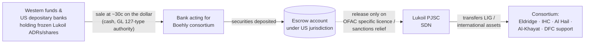

# Lukoil International Divestment — Boehly Consortium Securities Swap under OFAC GL 131K (November 2026)

In November 2026, Reuters reported that a consortium led by US investor Todd Boehly — with Emirati investors International Holding Company (IHC) and Al Hail Holding, the Syrian-Qatari Al-Khayat brothers, and backing from the US International Development Finance Corporation (DFC) — is preparing a **cashless securities swap** to acquire the international assets of sanctioned Russian oil major Lukoil. A bank acting for the consortium has reportedly bought billions of dollars of frozen Lukoil securities from Western funds at roughly 30 cents on the dollar, to be placed in **escrow** and exchanged for Lukoil International GmbH (LIG) assets.

The structure is an OFAC case study on three fronts: (i) how a buyer engineers consideration to fit OFAC's published "no windfall to Lukoil" condition; (ii) the limits of a **negotiation-only general licence** (GL 131K) that expressly withholds completion authority; and (iii) the Gulf dimension — UAE sovereign-linked capital acting inside a US-licensed divestment of a Russian SDN's assets, with direct relevance to UAE-based compliance functions.

> **Source and verification status:** The consortium's composition, the securities purchases, the 30-cent pricing and the escrow mechanism are reported by Reuters (3 Nov 2026) on the basis of unnamed sources; none of the named parties has confirmed them. The OFAC authorisation framework (GL 131K; FAQ 1224) is drawn from primary sources and is verified. The final asset perimeter, price and approval status are **unconfirmed**. Items that rest only on press sourcing are labelled in the [Contested Items](#contested-and-unverified-items) section.

---

## Key Facts

- **Target:** Lukoil International GmbH (LIG, Austria) and majority-owned subsidiaries — Lukoil's non-Russian oilfield, refining and retail portfolio
- **Designation:** Lukoil (and Rosneft) added to the SDN List under E.O. 14024, 22 October 2025; UK designations in parallel (October 2025)
- **Governing authorisation:** Russia-related **GL 131K** (21 Oct 2026) — negotiations and *contingent* contracts only; expires 12:01 a.m. EST, **21 November 2026**
- **Completion:** requires a **separate specific licence** from OFAC — not authorised by GL 131K
- **OFAC published conditions (FAQ 1224):** full severance of LIG from Lukoil; funds owed to Lukoil blocked in an account under US jurisdiction until sanctions are lifted; **no windfall to Lukoil, including up-front value via asset or share swaps**; purchasers likely required to seek OFAC review before onward divestment of material LIG assets
- **Reported bidder:** Boehly-led consortium (Eldridge) + IHC + Al Hail Holding + Al-Khayat brothers; DFC reportedly backing
- **Reported consideration:** frozen Lukoil securities bought from ~10 US/UK funds and US depositary banks (retail ADR holders) at ~30 cents on the dollar; held in escrow rather than transferred to Lukoil
- **Historical valuation reference:** ~USD 22 bn for the international portfolio at the start of the process (Reuters); value has since deteriorated as some assets stopped operating
- **Status (6 Nov 2026):** negotiations ongoing; no OFAC completion licence; deal "expected within weeks" per Reuters sources

---

## Timeline

| Date | Event |
|---|---|
| 22 Oct 2025 | OFAC designates Rosneft and Lukoil (E.O. 14024); wind-down GLs 126–128 issued to 21 Nov 2025 |
| Oct 2025 | UK designates Lukoil in parallel; Lukoil announces intention to sell international assets |
| Nov 2025 | Gunvor offer for LIG withdrawn after Treasury publicly rejects it; OFAC issues **GL 131** (14 Nov) authorising negotiations/contingent contracts for LIG sale |
| Dec 2025 | GL 131A; Treasury rejects an offer from a group including Xtellus Partners, stating Lukoil should receive no windfall in shares or cash |
| Jan 2026 | Carlyle announces conditional agreement for LIG (Kazakhstan assets excluded) |
| Feb 2026 | Reuters: US slowed the sale partly as leverage in Ukraine negotiations |
| Mar–Sep 2026 | Rolling extensions GL 131B–131J; FAQ 1224 publishes OFAC's minimum transaction conditions |
| Oct 2026 | Carlyle withdraws; GL 128D / 130B (15 Oct) and **GL 131K** (21 Oct) issued, negotiation window to 21 Nov 2026 |
| 3 Nov 2026 | Reuters exclusive: Boehly-led consortium preparing securities swap; bank has acquired frozen Lukoil securities at ~30c |
| 21 Nov 2026 | GL 131K expiry — negotiation authority lapses unless extended (GL 131L) or superseded by a specific licence |

---

## Mechanism: The Securities Swap

### Why consideration in Lukoil's own paper?

OFAC's published floor for any LIG sale (FAQ 1224) is that Lukoil must not receive a windfall and that **anything owed to it is blocked in a US-jurisdiction account until sanctions are lifted**. A conventional cash deal therefore gives Lukoil nothing usable today either — but a cash price crystallises a number OFAC has to defend politically and that Moscow can point to.

Paying in Lukoil's *own* frozen equity has three design effects:

1. **Cashless at the Lukoil interface.** No dollars move to the SDN. The consortium's cash outlay goes to Western (US/UK) holders, i.e. to persons the sanctions regime is designed to protect, not to the target.
2. **Value is pre-blocked by construction.** Securities in an escrow account subject to US jurisdiction are already in the condition FAQ 1224 requires — "held until sanctions are lifted" — without needing a bespoke blocked-payment structure.
3. **Treasury's "no windfall in shares or cash" test is met by sequencing, not by substance.** Treasury rejected the Xtellus structure (Dec 2025) because it would have transferred shares to Lukoil. The escrow interposition is the specific fix: Lukoil obtains no title and no control pending separate authorisation. *This is the central legal question of the case* — whether escrowed equity the SDN cannot touch is "up-front value" within OFAC's meaning.

### Who actually pays whom

| Party | Gives | Receives |
|---|---|---|
| Western funds / ADR holders | Frozen Lukoil securities (written down) | Cash at ~30c on the dollar — an exit from a stranded position |
| Consortium | Cash to Western holders; cost of asset stewardship | LIG assets (if licensed) |
| Lukoil | LIG assets | Escrowed claim to its own treasury stock — contingent, blocked, uncertain |
| US Treasury | A specific licence (if granted) | Russian major divested of foreign assets with no liquidity to Moscow; US and Gulf control of European refining and Iraqi upstream |

> **Analytical note:** the 30-cent price is a discount on *Lukoil's sanctioned securities*, reflecting their illiquidity and blocked status. It is **not** a 70% discount on the underlying operating assets, and the USD 22 bn figure is an early-process valuation, not a transaction price. Any "bargain" narrative conflates the two.

---

## The Authorisation Architecture

### GL 131K — what it permits and what it withholds

| Authorised under GL 131K | **Not** authorised |
|---|---|
| Negotiations with Lukoil on sale of LIG or its majority-owned subsidiaries | Closing / performance of any sale contract |
| Entry into **contingent** contracts — performance must be expressly conditional on separate OFAC authorisation | Any transfer of funds to a person or account in the Russian Federation |
| Financial, legal and operational due diligence, incl. engaging outside counsel and advisers | Transactions with LIG entities beyond the licence's maintenance/wind-down scope |
| Maintenance and wind-down of LIG operations within the licence terms | Onward divestment of material LIG assets without OFAC review (expected condition of any specific licence) |

OFAC's FAQ language adds a discretionary trigger that practitioners should weight heavily: the licence **may be revoked at any time** if Lukoil and LIG do not appear to be negotiating in good faith. The GL is therefore a leash, not a safe harbour — Treasury has used the rolling 30–60-day renewals (131 → 131K in twelve months) to keep the process under continuous political control, and Reuters' February 2026 reporting that the pace was tied to Ukraine negotiations is consistent with that reading.

### The parallel licences

- **GL 128D** — Lukoil retail service stations outside Russia (purchases, maintenance, operation, wind-down).
- **GL 130B** — Bulgarian assets (Burgas refinery complex), where the Bulgarian state has taken special administrative control.
- **GL 124-series** — Kazakhstan pipeline carve-outs (CPC / Tengizchevroil), which explain why Kazakhstan was excluded from the Carlyle perimeter.
- **GL 127** (now superseded) — debt/equity/derivative transactions in Lukoil securities; the legal basis for secondary trading in frozen Lukoil paper by US persons needs to be checked against the current GL text at the date of each trade.

### Where the completion licence will be decided

The specific licence is a Treasury policy decision, not a technical determination, and sits alongside UK OFSI (Lukoil is UK-designated; LITASCO and the Zeeland stake sit in UK/EU exposure), EU Member State authorities (Netherlands, Bulgaria, Romania), and Iraqi and Azerbaijani host-government consents for West Qurna-2 and Shah Deniz. A US licence is necessary but nowhere near sufficient.

---

## Reported Asset Perimeter (historical holdings)

The assets below are Lukoil's documented international interests; **the final perimeter of the Boehly proposal is undisclosed** and some positions have changed status since October 2025 (Iraq moved to displace Lukoil from West Qurna-2; Bulgaria imposed a special manager on Burgas).

| Jurisdiction | Asset | Lukoil interest (historical) | Notes |
|---|---|---|---|
| Iraq | West Qurna-2 | 75% (operator) | Force majeure declared Nov 2025; Iraqi government moved to take over operations — status contested |
| Azerbaijan | Shah Deniz | 19.99% | BP-operated; partner consents and pre-emption rights apply |
| Netherlands | Zeeland Refinery N.V. | 45% via LITASCO (Switzerland) | TotalEnergies 55%; Dutch economic ministry oversight |
| Bulgaria | LUKOIL Neftochim Burgas AD | 100% | State-appointed special manager since Nov 2025; covered by GL 130B |
| Romania | Petrotel Lukoil Refinery (Ploiești) | 100% | Romanian government contingency review |
| Kazakhstan | CPC, Karachaganak, Tengiz-related stakes | Various | Excluded from Carlyle deal; GL 124-series carve-outs |
| Multiple | Retail networks (c. 2,000+ stations outside Russia) | 100% | GL 128D |

---

## Doctrinal Significance

### 1. Divestment-by-sanction as a tool of economic statecraft

The sale tests whether a blocking designation can be used not merely to freeze a Russian major's foreign assets but to **compel their transfer to buyers chosen, in practice, by Washington** — while denying the seller any proceeds. The GL 131 series is the operative instrument: it keeps the asset base from collapsing (maintenance authority), keeps the seller at the table (good-faith revocation clause), and reserves the final decision (contingent-contract requirement). This is a different model from the 2022–2024 Russian-asset experience, where Western companies divested *out of* Russia on Moscow's terms.

### 2. "Windfall" as a sanctions concept

FAQ 1224 converts an informal Treasury statement (the Xtellus rejection) into a published licensing standard. "No up-front value, including through asset or share swaps" is now a condition that practitioners must structure around, and the Boehly escrow is the first reported structure built specifically to satisfy it. Whether OFAC accepts that escrowed equity is *not* up-front value will set the precedent for every future SDN divestment — Rosneft's Nayara, Novatek's LNG stakes, and the Iranian and Venezuelan analogues.

### 3. Secondary-market monetisation of frozen securities

The consortium's bank has effectively created a bid for an asset class — sanctioned Russian equity held by Western funds — that had been marked near zero. Three compliance questions follow for any fund or custodian on the selling side:

- Was the sale authorised (GL 127-series or successor, or a specific licence) at the date of trade, and was the counterparty bank a non-blocked person?
- Were proceeds free of any routing to Russia or to Lukoil?
- Does the fund's own sanctions policy (and, for UK/EU funds, OFSI/EU asset-freeze rules) permit disposal of a frozen position to a third party rather than requiring it to remain frozen?

### 4. The Gulf capital dimension

IHC and Al Hail Holding are Abu Dhabi investment groups; the Al-Khayat family is Qatar-based. Their presence in a US-licensed structure illustrates the direction of travel discussed in [BIS Affiliates Rule](../regulations/uae/bis-affiliates-rule.md) and the [UAE jurisdiction pages](../regulations/uae/index.md): UAE entities are increasingly **inside** US sanctions architectures as licensed counterparties rather than only as screening risks. The compliance consequence for UAE-based groups is symmetrical — the same ownership chains that make a UAE entity an attractive licensed buyer make its downstream affiliates subject to OFAC's expected onward-divestment review condition, and to UK/EU regimes where the acquired assets sit.

### 5. The DFC's role

Reported DFC backing would place a US government development-finance institution inside a transaction whose underlying value flows from the enforcement of US sanctions. If confirmed, this is a notable fusion of financial statecraft and sanctions policy, and it would bring Congressional notification and DFC's own environmental, social and governance review into the approval path.

---

## Compliance Takeaways for Counterparties

**For UAE / GCC groups contemplating participation or financing:**

- Treat GL 131K as a negotiation licence only; no capital commitment should be unconditional before a specific licence issues, and every term sheet must carry the express contingency language the GL requires.
- Model the 21 November 2026 cliff: if 131K is not renewed, negotiations themselves become unauthorised for US persons and for any transaction with a US nexus (USD clearing, US advisers, US-person directors).
- Map UK and EU exposure separately — a US licence does not unfreeze LITASCO, Zeeland, Burgas or Petrotel under OFSI or EU regimes.
- Expect an onward-divestment review covenant and build it into any JV or syndication structure from the outset.

**For funds and custodians holding Lukoil securities:**

- Confirm the authorisation basis for any secondary sale at the trade date; retain the GL text relied on in the transaction file.
- Screen the purchasing bank and its principals; confirm no proceeds route to Russia.
- Document the valuation rationale for accepting ~30c given the write-down already taken — this is a fiduciary record as much as a sanctions record.

**For energy operators with JV interests alongside Lukoil (Iraq, Azerbaijan, Netherlands):**

- Pre-emption and change-of-control provisions in the JOA / shareholders' agreement are now live; host-government consent is a separate gate from OFAC.
- Any payment to or from a Lukoil-affiliated JV partner remains blocked absent licence; the maintenance authority in GL 131K covers LIG entities, not the JV partners' own obligations.

---

## Contested and Unverified Items

| Item | Status | Source quality |
|---|---|---|
| Consortium composition (Boehly / IHC / Al Hail / Al-Khayat / DFC) | Reported; IHC "does not comment"; others no response | Reuters, four unnamed sources |
| Bank purchased "billions" of Lukoil securities at ~30c | Reported | Reuters, two unnamed sources |
| Escrow mechanism accepted by Treasury as basis to proceed | Reported; Treasury did not respond | Reuters, two unnamed sources |
| Deal "expected within weeks" | Reported | Reuters sources |
| Final asset perimeter and price | **Undisclosed** | — |
| DFC backing and its form (equity, guarantee, loan) | Reported; DFC no response | Reuters |
| USD 22 bn valuation | Historical reference at start of process; not a current price | Reuters (citing earlier reporting) |

The GL 131K terms, the 21 November 2026 expiry and the FAQ 1224 conditions are **verified against OFAC primary sources**.

---

## Sources

**Primary**

- OFAC, Russia-related General License No. 131K, *Authorizing Certain Transactions for the Negotiation of and Entry Into Contingent Contracts for the Sale of Lukoil International GmbH and Related Maintenance Activities* (21 Oct 2026) — <https://ofac.treasury.gov/media/937276/download>
- OFAC, FAQ 1224 — negotiations authorised and transaction conditions for LIG sale — <https://ofac.treasury.gov/faqs/1224>
- OFAC, Recently Updated FAQs, 21 Oct 2026 — <https://ofac.treasury.gov/faqs/updated/2026-10-21>
- OFAC, Russia-related General Licenses 128D and 130B (15 Oct 2026); GL 131E and FAQs (29 Apr 2026) — <https://ofac.treasury.gov/recent-actions/20260429>
- Federal Register, 91 FR 10004 (2 Mar 2026) — publication of GLs 130, 131, 131A, 128, 128B — <https://www.govinfo.gov/content/pkg/FR-2026-03-02/pdf/2026-04087.pdf>
- E.O. 14024; 31 C.F.R. Part 587 (Russian Harmful Foreign Activities Sanctions Regulations)

**Secondary**

- Hirtenstein, Azhari & Renshaw, "Exclusive: US billionaire leads swap plan to buy Lukoil's overseas assets, sources say", *Reuters*, 3 Nov 2026
- Interfax, "U.S. OFAC extends Lukoil's license to sell foreign assets until Nov 21", 21 Oct 2026 — <https://interfax.com/newsroom/top-stories/119637/>
- Lewis Brisbois, "OFAC Widens the Door on Lukoil Divestments: Navigating GLs 131E and 128C", 13 May 2026
- Cleary Gottlieb, "OFAC General Licenses Open Door for Lukoil Divestment and Other Limited Activities Following Rosneft and Lukoil Sanctions", 20 Nov 2025
- Seward & Kissel, "OFAC Announces New Round of Sanctions Targeting Russian Oil Companies Lukoil and Rosneft", Oct 2025

**Related pages in this repository**

- [Sanctions — Oil & Energy](../regulations/sanctions-oil-energy.md)
- [OFAC UBO & 50% Rule](../regulations/ofac-ubo-50-percent-rule.md)
- [BIS Affiliates Rule (UAE)](../regulations/uae/bis-affiliates-rule.md)
- [M&A Export Controls Diligence Manual](../enforcements/ma-export-controls-diligence.md)
- [US Designations — OFAC Spring 2026 Wave](../jurisdictions/us/2026/ofac-spring-2026-wave.md)

---

*Case study prepared 6 November 2026. Informational only; not legal advice. Update on issuance of GL 131L or a specific licence, or on public confirmation of the consortium's terms.*
